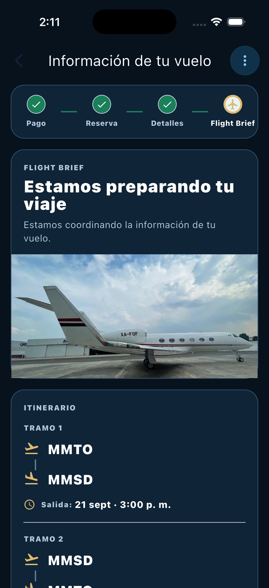
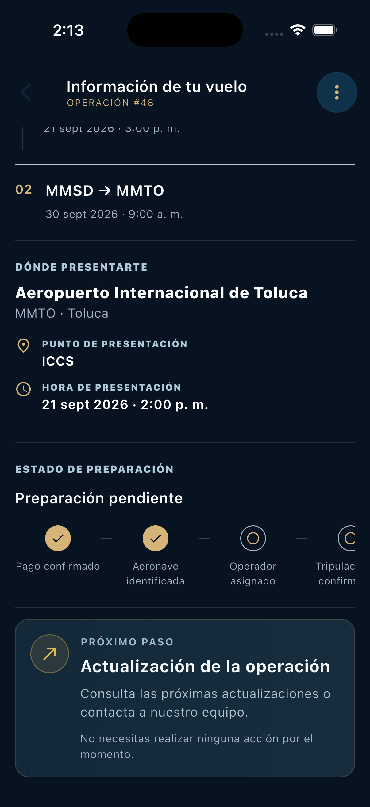

# Información de tu vuelo — rediseño Flight Brief

Fecha: 14 de octubre de 2026.

Se reemplazaron las tarjetas repetitivas por una superficie continua con separadores. La portada integra únicamente la imagen del objeto `brief.aircraft`; si falta o falla, aparece un degradado marino. El módulo de próximo paso conserva el único borde dorado inferior.

## Auditoría y procedencia

- Pantalla: `lib/screens/cliente/views/pantalla_flight_brief_cliente.dart`.
- Entrada: `_openFlightBrief` en `lib/screens/cliente/widgets/lista_vuelos_cliente.dart`, mediante `MaterialPageRoute`, con `flightRequestId` y la solicitud real.
- Servicio: `ApiClient.getFlightBrief`, GET autenticado `/client/flight-requests/{id}/flight-brief`.
- Modelo reutilizado: `FlightBrief`. No se modificaron modelos, servicios ni respuestas.
- Sincronización conservada: consulta inicial, temporizador de 20 segundos, retorno al primer plano, refresco manual, descarte de respuestas obsoletas y conservación del último contenido válido ante errores.
- Los pasajeros provienen de los campos existentes de la solicitud recibida por navegación. Si falta ese dato, aparece «Por confirmar»; el modelo `FlightBrief` no proporciona un conteo de pasajeros.
- El resumen identifica el primer tramo real cuando hay varios. No asume que sea el tramo actualmente en vuelo, pues el modelo no expone un estado operativo individual por tramo.
- Para la estructura antigua de una sola ruta, se presentan los campos existentes de salida/llegada. Si no hay datos de ruta, no se genera un tramo ficticio.

## Cambios y validación

| Archivo modificado | Componente rediseñado | Funcionalidad conservada | Resultado | Prueba ejecutada |
| --- | --- | --- | --- | --- |
| `lib/screens/cliente/views/pantalla_flight_brief_cliente.dart` | Encabezado, operación y portada integrada | Regresar, menú y datos reales de aeronave | Encabezado compacto, imagen pertinente y estado visible | Revisión en simulador iPhone y pruebas de estados |
| Mismo archivo | Resumen horizontal e itinerario | Todas las rutas y fechas recibidas, presentación por tramo | Timeline abierto, sin límite de dos tramos; franja desplazable | Una ruta antigua, dos tramos y cuatro tramos reales |
| Mismo archivo | Sección de presentación | Aeropuerto, punto, hora, dirección y enlace a mapas | Se conserva la información disponible; faltantes explícitos | Datos nulos, actualización de ubicación y retiro de datos tras refresco |
| Mismo archivo | Preparación y hitos | Confirmaciones independientes de pago, operador, tripulación, checklist y readiness | Indicador compacto con detalle desplegable accesible | Pago y operador pendientes aunque el checklist esté en proceso |
| Mismo archivo | Próximo paso unificado | Información operativa y ausencia de acción del cliente según el flujo existente | Un solo módulo inferior | Comprobación de contenido y eliminación del bloque duplicado |
| `test/screens/cliente/views/pantalla_flight_brief_cliente_test.dart` | Pruebas ampliadas | Cobertura de sincronización y navegación anterior | 17 pruebas correctas | Casos operativos, datos parciales, accesibilidad y regresión |
| `docs/reports/flight-brief/` | Evidencia y reporte | Datos reales en capturas del simulador | Evidencia visual documentada | Inspección de capturas |

## Resultados

- `dart format` ejecutado sobre ambos archivos Dart modificados.
- `flutter test`: **279 pruebas correctas y 1 omitida**.
- Tras el último ajuste visual del distintivo y los separadores, se repitieron las **17 pruebas de Flight Brief**, todas correctas.
- `flutter analyze`: dos advertencias preexistentes en `lib/core/app_theme.dart:1`, relativas al import de `CupertinoPageTransitionsBuilder`. Sin incidencias en los archivos modificados.
- `git diff --check`: correcto.
- Widget tests en 320, 360, 375, 390 y 430 px, temas iOS y Android, escalas de texto 1 y 2, e insets de 59 px arriba y 34 px abajo. Sin desbordamientos durante el scroll.
- iPhone: revisión visual de la aplicación real en el simulador iPhone 17 Pro, incluida la fotografía asignada, itinerario, presentación y estado de preparación.
- Android nativo: pendiente; el dispositivo detectado no está autorizado. La adaptación con tema Android sí se comprobó mediante widget tests.

## Estados y datos incompletos

Se probaron: pendiente, confirmado, preparación, en vuelo, `tracking_live`, finalizado, cancelado aun con readiness activo, estado desconocido y pago confirmado sin confirmación del vuelo. También se cubrieron falta de imagen, ubicación y hora de presentación, ausencia de ruta, checklist incompleto y checklist completo sin autorización operativa de salida.

`tracking_live` conserva el significado de «En operación» definido por la aplicación; no afirma que la aeronave esté en el aire. El pago confirmado no se interpreta como vuelo confirmado. La presencia del modelo de aeronave se describe como «Aeronave identificada», pues no existe un campo de confirmación de asignación en ese objeto. Completar un checklist tampoco se convierte en autorización de salida si `readiness.ready` no lo confirma.

La preparación completada o pendiente depende de los datos recibidos. No se marcan pasos como completados por su posición. No se calculan horas de presentación ni se insertan FBO, aeropuertos o fotografías ajenos a la operación.

## Funcionalidades protegidas

No se modificaron estados del backend, autenticación, Stripe, pagos, notificaciones, permisos, documentación, base de datos, APIs, motor de cotización ni selección de aeronaves. Se conserva la navegación de entrada y regreso, el menú lateral de acciones, el seguimiento y los enlaces existentes. Los campos mostrados proceden del Flight Brief o de la solicitud real que abrió la pantalla; las etiquetas explicativas son únicamente presentación.

Los cambios previos del catálogo de aeronaves y del resumen de cotización se conservaron.

## Capturas

Antes, en el simulador:

Rediseño, durante la revisión visual en el simulador. Esta captura muestra las secciones inferiores; el indicador se refinó posteriormente a una línea compacta con detalle desplegable:

El usuario indicó continuar sin una nueva captura final cuando el simulador cambió a otra pantalla. La imagen anterior documenta la revisión intermedia y no sustituye una captura del último ajuste.
